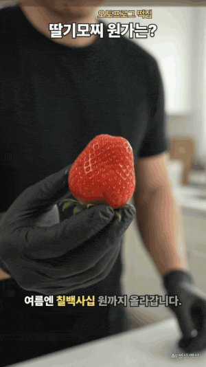
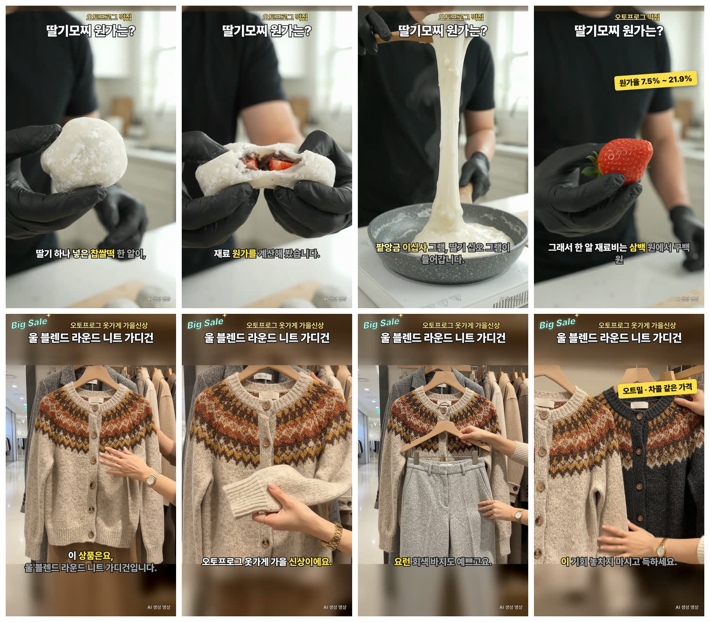

<h1 align="center">🐸 frogshorts</h1>

<p align="center"><b>따라 하고 싶은 쇼츠 주소 하나, 우리 가게 소개 몇 줄.<br>
그러면 같은 짜임새로 만든 "우리 가게 쇼츠"가 9:16 완성본으로 나옵니다.</b></p>

<p align="center">
  
  
  
  
</p>

<table align="center">
<tr>
<td width="50%" align="center"><a href="https://raw.githubusercontent.com/d-onworks/frogshorts/main/media/ddeok.mp4"></a></td>
<td width="50%" align="center"><a href="https://raw.githubusercontent.com/d-onworks/frogshorts/main/media/clothes.mp4"></a></td>
</tr>
<tr>
<td align="center"><b>떡집 · 딸기모찌</b><br><sub>재료 원가를 직접 계산해 보는 영상 — 말에 맞춰 원가율 배지가 뜹니다</sub></td>
<td align="center"><b>옷가게 · 니트 가디건</b><br><sub>매장에서 상품을 소개하는 영상 — 두 색이 같은 가격이라는 배지가 뜹니다</sub></td>
</tr>
</table>

<p align="center"><sub>그림을 누르면 소리 있는 30초 완성본(mp4)을 받아 볼 수 있습니다 · 두 편 모두 frogshorts 로 만들었고, 화면은 AI 가 만든 장면입니다(가상의 가게)</sub></p>

---

## 이런 분께 만들었습니다

- 가게 쇼츠를 올려야 하는데, 촬영하고 편집할 시간이 없는 사장님
- 잘된 쇼츠를 보면 "우리 가게도 저렇게" 싶은데, 어디서부터 따라 해야 할지 모르는 분
- 한 편 만들고 나면 상품만 바꿔서 여러 편을 뽑고 싶은 분

frogshorts 는 참고 영상을 그대로 베끼지 않습니다. **장면 순서, 말의 리듬, 자막과 가격표가 뜨는 자리** 같은 짜임새만 가져와서, 우리 가게 상품과 우리 대사로 새로 만듭니다.

## 이렇게 만들어집니다

<p align="center"></p>

| 단계 | 하는 일 | 사람이 하는 일 |
|---|---|---|
| **1. 참고 영상 분석** | 영상을 받아 단어 하나하나가 몇 초에 나오는지 받아쓰고, 화면을 칸칸이 뽑아 짜임새를 정리합니다 | 따라 하고 싶은 쇼츠 주소 붙여 넣기 |
| **2. 우리 가게 정보** | 가게 이름·상품·가격·하고 싶은 말을 짜임새에 맞춰 대본과 장면으로 바꿉니다 | 가게 소개 몇 줄 적기 |
| **3. 완성** | AI 가 장면 영상을 만들고, AI 성우가 대본을 읽고, 자막·가격표·엔딩 카드를 **말하는 단어에 맞춰** 얹습니다 | 완성본 보고 고칠 곳 말하기 |

대사 한 줄을 고치면 그 줄만 다시 녹음하고, 자막과 가격표가 바뀐 말에 맞춰 저절로 자리를 옮깁니다. 이미 만든 장면은 다시 만들지 않으니, **변형을 뽑을 땐 바뀐 부분 값만 듭니다.**

---

## 설치는 클로드에게 한마디

필요한 것은 **구글 계정 하나**와 **클로드**(VS Code 의 클로드 코드 또는 클로드 앱)뿐입니다.

**① 저장소 받기** — 클로드에게 이렇게 말합니다.

```
https://github.com/d-onworks/frogshorts.git 깃 클론 해줘
```

**② 설치와 구글 연결** — 받은 `frogshorts` 폴더를 열고 클로드에게 이렇게 말합니다.

```
README 읽고 실행해줘
```

클로드가 이 문서 맨 아래의 [설치 순서](#클로드가-따를-설치-순서)를 보고 필요한 프로그램 설치부터 구글 연결, 시험 호출까지 알아서 합니다. 그동안 직접 하실 일은 두 가지뿐입니다.

- 브라우저에 구글 로그인 창이 뜨면 → **내 구글 계정으로 로그인하고 '허용'**
- 윈도우에서 "이 앱이 디바이스를 변경할 수 있도록 허용하시겠어요?" 창이 뜨면 → **'예'**

화면에 **"Vertex AI 연결되었습니다"** 가 나오면 준비 끝입니다. 클로드가 다음에 할 일을 알려 드립니다.

> **구글 클라우드가 처음이신가요?** [무료 체험](https://console.cloud.google.com/freetrial)을 먼저 시작해 두세요. 카드 등록은 필요하지만, 직접 '업그레이드'를 누르기 전에는 결제되지 않습니다(크레딧 $300 · 90일). 설치 중에 필요하면 클로드가 이 주소를 알려 드립니다.

<details>
<summary><b>uv 가 뭔가요? (설치 중에 보이는 이름)</b></summary>

frogshorts 는 파이썬으로 만든 프로그램입니다. 코드는 ①에서 `git clone` 으로 이미 받았고, **uv** 는 그 코드를 돌리기 위한 준비 담당입니다. 파이썬 3.12 와 필요한 부품 두 개(pyyaml, pillow)를 frogshorts 폴더 안에만 따로 준비한 뒤 실행해 줍니다. PC 에 깔린 다른 파이썬은 건드리지 않습니다.

요리로 비유하면 `git clone` 은 요리책 받기, uv 는 재료 사 오고 주방 차리기입니다. 처음 한 번만 준비하고, 다음부터는 바로 실행됩니다.
</details>

<details>
<summary><b>클로드 없이 직접 설치하려면</b></summary>

내려받은 `.bat` 같은 실행 파일은 쓰지 않습니다. 공식 패키지 관리자(윈도우 winget · 맥 Homebrew)로 git 과 uv 를 깔고 시작합니다.

**윈도우** — 시작 메뉴에서 "터미널"(또는 PowerShell)을 엽니다.
```powershell
winget install -e --id Git.Git --source winget --accept-package-agreements --accept-source-agreements
winget install -e --id astral-sh.uv --source winget --accept-package-agreements --accept-source-agreements
```
터미널을 닫고 새로 연 뒤
```powershell
git clone https://github.com/d-onworks/frogshorts.git
cd frogshorts
uv run frogshorts setup
```

**맥** — "터미널" 앱을 엽니다(Homebrew 가 없으면 [brew.sh](https://brew.sh) 의 한 줄을 먼저).
```bash
brew install git uv
git clone https://github.com/d-onworks/frogshorts.git
cd frogshorts
uv run frogshorts setup
```

준비 마법사가 아래 순서로 진행합니다.

| 단계 | 하는 일 | 내가 할 것 |
|---|---|---|
| 0 | `frogshorts` 명령 등록(새 창 어느 폴더에서든 부르게) | 없음 |
| 1 | ffmpeg · yt-dlp · node · hyperframes · gcloud · 받아쓰기(whisper) 확인 → 없으면 자동 설치 | "설치할까요?"에 Enter (윈도우는 허용 창에 '예') |
| 2 | 내 구글 계정 연결 | 브라우저가 열리면 내 구글 계정으로 로그인 → 허용 |
| 3 | 구글 클라우드 프로젝트 고르기 → `frogshorts.toml` 에 자동 저장 | 여러 개면 번호 고르기 |
| 4 | Vertex AI 켜기 · 결제(무료 크레딧) 연결 확인 | 결제가 안 돼 있으면 안내된 주소에서 연결 |
| 5 | 시험 호출(글 한 줄, 1원 미만) | 없음 — "Vertex AI 연결되었습니다"가 나오면 끝 |

막히면 ✗ 줄 아래 → 안내대로 고치고 같은 명령을 다시 실행하세요. 된 단계는 건너뛰고 이어서 합니다. 끝나면 새 터미널에서 `frogshorts …` 로 부르면 되고, 언제든 `frogshorts doctor` 로 점검할 수 있습니다.

더빙·글씨 찾기를 AI Studio API 키로 부르고 싶다면 `frogshorts.toml` 의 `[gemini] via = "apikey"` 와 `.env` 의 `GEMINI_API_KEY=…` 를 쓰면 됩니다.
</details>

---

## 첫 영상 만들기

클로드에게 말로 시켜도 되고, 명령을 직접 쳐도 됩니다. 예시는 가상의 가게 "초록연못 빵집"입니다.

| 클로드에게 하는 말 (예) | 실제로 도는 명령 |
|---|---|
| "이 쇼츠 분석해 줘" + 쇼츠 주소 | `frogshorts analyze <주소> -o work/빵집` |
| "우리 빵집 정보로 계획 세워 줘" | `frogshorts plan work/빵집 --brief briefs/예시-초록연못빵집.yaml` |
| "얼마 드는지 먼저 보여 줘" | `frogshorts make work/빵집` (계획과 예상 비용만, 돈 안 듦) |
| "좋아, 만들어 줘" | `frogshorts make work/빵집 --go` |
| "상품만 바게트로 바꾼 버전도" | `frogshorts variant work/빵집 --name 바게트 --set 상품="바게트"` → `--go` |

- 완성본은 `work/빵집/output/` 에 1080×1920, 소리 크기 -14 LUFS(유튜브 기준)로 나옵니다.
- 내 가게로 할 때는 `briefs/예시-초록연못빵집.yaml` 을 복사해서 가게 이름·상품·대사만 바꾸면 됩니다.
- 변형은 먼저 컷마다 "그대로 / 다시 만듦(이유)"과 돈 드는 곳만 보여 드리고, `--go` 를 붙여야 만듭니다.

## 비용은 얼마나 드나요

- 모든 비용은 **내 구글 클라우드 프로젝트**에서 나갑니다. 무료 체험 크레딧이 있으면 거기서 먼저 빠집니다.
- 돈이 드는 생성은 `--go` 를 붙였을 때만 합니다. 그 전에 **예상 비용을 먼저 보여 드리고**, 만들 때마다 "어느 계정·어느 프로젝트에서 나가는지"를 한 줄로 알려 드립니다.
- 위 예시 두 편은 각각 AI 장면 3개(약 30초 분량)를 만들어 장면 값이 약 $3씩 들었습니다(만들 당시 단가 기준). 영상 모델은 항상 그때의 최신판을 자동으로 고르고, 단가도 그에 맞춰 계산합니다.
- AI 성우 녹음과 화면 글씨 찾기는 같은 프로젝트에서 문장당·화면당 몇 원 수준입니다.
- 같은 재료로 만든 장면은 다시 돈을 쓰지 않습니다.

## 솔직하게 말씀드립니다

- **화면은 AI 가 만든 장면입니다.** 실제 매장 촬영처럼 보이게 속이지 않도록 완성본에 기본으로 AI 표시가 들어갑니다. 가짜 후기, 가짜 통계, 없는 할인율은 쓰지 않습니다.
- **AI 장면에는 가끔 이상한 글자나 손가락이 생깁니다.** 그래서 만들고 나면 장면을 칸칸이 뽑은 검수 그림(`검수/` 폴더)이 함께 나옵니다. 확인하고 문제 있는 장면만 다시 만드세요.
- **"이 컷이 이 단어에 맞춰 바뀐다"는 판단은 도구가 아니라 클로드의 해석입니다.** 분석 결과에는 근거가 된 화면과 시각을 함께 남깁니다.
- 참고 영상의 소리와 구성은 그 영상을 만든 분의 것입니다. 원본을 그대로 재현하는 모드(`원본재현`)는 연습·강의용이고, 올리려면 권리부터 확인해 주세요.
- 실제 손님의 얼굴이나 목소리가 들어가면 올리기 전에 꼭 허락을 받으세요.

---

<details>
<summary><b>자세한 사용법 — 작업파일(shorts.yaml)과 모든 명령</b></summary>

### 작업파일(shorts.yaml) 핵심

- **`대사:` 가 말의 유일한 원본입니다.** 자막은 대사 글 그대로, 더빙은 `발음:` 표를 적용한 소리로 읽습니다. `|` 를 넣은 자리에서 자막을 끊습니다. 숫자는 한글로 적으면 받아쓰기와 더 잘 맞습니다.
- **화면은 "몇 초"가 아니라 "대사의 어느 단어"에 붙습니다(앵커).**

  | 앵커 | 뜻 |
  |---|---|
  | `대사3` | 3번 대사 첫 단어 시작 |
  | `대사3:차콜` · `대사3:차콜#2` | '차콜'이 들어간 첫(두 번째) 단어 시작 |
  | `대사3:차콜(끝)` · `대사3:끝` | 그 단어가 끝나는 때 · 3번 대사 마지막 단어 끝 |
  | `대사3:차콜 -0.2초` · `+5f` | 그만큼 앞당기거나 늦춤(f = 프레임) |

  대사를 고치면 그 줄만 다시 더빙 → 단어 시각을 다시 맞춤 → 화면이 따라옵니다. 붙어 있던 단어가 대사에서 사라지면 조용히 넘기지 않고 멈춥니다. 받아쓰기에서 못 찾아 시각을 '추정'한 단어에 앵커가 걸리면 경고합니다.
- **컷**: `길이: 3~최대 | 자동`(자동 = 더빙 길이에 맞춰 필요한 만큼만 생성, 최대 길이는 모델마다 다름) · `참조: A@0`(앞 컷 첫 화면) · `참조: [원본@4.2, 원본@4-7]`(참고 영상의 정지 화면·3초 동작 영상) · `흐림:`(손으로 적는 글씨 가림 영역) · `고정:`(재료가 바뀌어도 이 클립 그대로).
- **부품**: `배너` · `자막`(노래방식, 실제 글꼴 너비로 2줄 이내) · `배지` · `엔딩` · `AI표시` · `랭킹` · `댓글`. `댓글` 은 실제 댓글만 씁니다. `출처:` 에 댓글 링크를 적고, 시연용이면 `출처: 예시`(화면에 "예시 댓글" 표시가 붙습니다).
- **마감**: `해상도: 720p | 1080p` · `글씨흐림: 자동 | 끔` · `자막강조: 현재 | 누적` · `LUFS: -14` 등.
- **모드**: `새대사`(기본, 새 더빙 기준) · `원본재현`(`frogshorts plan … --mode 원본재현`, 원본 구간·길이·소리 기준, 연습·강의용).

### 변형 뽑기

```bash
frogshorts variant work/빵집 --name 바게트 --set 상품="바게트" --set 대사.2="겉은 바삭하고 속은 쫄깃해요."
frogshorts variant work/빵집 --name 바게트 --go
frogshorts variant work/빵집 --name 바게트 --keep A --go     # 컷 A 는 원본 클립을 그대로(돈 0)
```

### 그 밖의 명령

| 명령 | 하는 일 |
|---|---|
| `frogshorts estimate work/빵집` | 더빙 전에 대사 길이·필요 클립 수·비용을 어림 |
| `frogshorts estimate --text "문장"` | 문장 하나 길이(숫자는 읽는 소리로: 4,500원 → 사천오백원) |
| `frogshorts snapshot work/빵집 --at "대사2:결이,대사4:일찍"` | 완성본에서 그 말이 나올 때 화면만 뽑아 보기 |
| `frogshorts snapshot work/빵집 --around "대사2:결이"` | 그 말 앞뒤 1초를 촘촘히(컷 넘김 확인) |
| `frogshorts adopt work/빵집 A=내클립.mp4` | 이미 만든 클립을 컷 A 로 등록(출처 기록) |
| `frogshorts ledger` | 영상 생성 장부(건수·추정 비용·최근 실패 이유) |
| `frogshorts doctor` | 설치·로그인·권한 점검 |

### 막혔을 때

- `frogshorts doctor` 결과의 ✗ 줄부터 해결하세요.
- 생성이 `safety`(안전 필터)로 막히면, 무엇에 걸렸는지는 알려 주지 않습니다. 강제·위험해 보이는 동작 묘사를 부드럽게 고쳐 그 컷만 다시 `--go` 하세요. 앞 컷은 캐시로 다시 씁니다. 실패 이유는 `frogshorts ledger` 에 남습니다.
- "로그인이 만료됐다"가 나오면 `frogshorts setup` 을 다시 실행하세요. 2단계에서 다시 로그인합니다.
- 개발·시험: `uv venv .venv -p 3.12` → `uv pip install --python .venv -e ".[dev]"` → `.venv/bin/python -m pytest -q` (돈 드는 호출은 가짜로 바꿔 시험합니다).

### 함께 들어 있는 것

글꼴 Pretendard(SIL OFL 1.1), 애니메이션 라이브러리 GSAP 3.15(무료 라이선스) 사본 — `frogshorts/parts/`.
</details>

---

## 클로드가 따를 설치 순서

> 사용자가 "README 읽고 실행해줘"라고 하면 클로드(AI 도우미)는 아래 순서대로 진행합니다.
>
> 1. `uv --version` 으로 uv 가 있는지 봅니다. 없으면 설치합니다 —
>    윈도우 `winget install -e --id astral-sh.uv --source winget --accept-package-agreements --accept-source-agreements`,
>    맥 `brew install uv`. 설치 뒤 `uv` 가 안 잡히면 PATH 에 `~/.local/bin`(윈도우 `%USERPROFILE%\.local\bin`)과
>    winget 링크 폴더(`%LOCALAPPDATA%\Microsoft\WinGet\Links`)를 더해 다시 시도합니다.
> 2. 이 폴더에서 `uv run frogshorts setup --yes` 를 실행합니다(명령 시간 제한은 넉넉히 10분). 묻지 않고 진행하며,
>    프로그램 자동 설치 → 구글 로그인 → 프로젝트 저장 → Vertex AI 켜기 → 시험 호출 순서입니다.
>    브라우저 로그인 창이 열리면 사용자에게 "브라우저에서 내 구글 계정으로 로그인하고 허용을 눌러 주세요"라고 말합니다.
>    시간이 다 돼 끊기면 같은 명령을 다시 실행합니다(된 단계는 건너뜁니다).
> 3. `✗` 줄이 나오면 바로 아래 `→` 줄을 사용자에게 쉬운 말로 전합니다. 무료 체험 가입·결제 연결처럼 **사용자가 웹에서
>    해야 하는 일은 사용자에게 맡기고**, 끝났다고 하면 같은 명령을 다시 실행합니다.
> 4. **"Vertex AI 연결되었습니다"** 가 나오면 끝입니다. 마지막의 "이제 이렇게 만든다" 안내를 사용자에게 전합니다.
>    프로젝트가 여러 개라 첫 번째로 골랐다는 줄이 있으면 어느 프로젝트로 했는지도 알려 줍니다.
>
> 지킬 것: 비밀번호·카드번호·키를 묻거나 받지 않습니다. gcloud 기본 계정·다른 프로젝트 설정을 바꾸지 않습니다.
> 돈이 드는 생성(`make … --go`, `variant … --go`)은 사용자가 시킬 때만 하고, 그 전에 `--go` 없이 돌려 예상 비용을 보여 줍니다.
